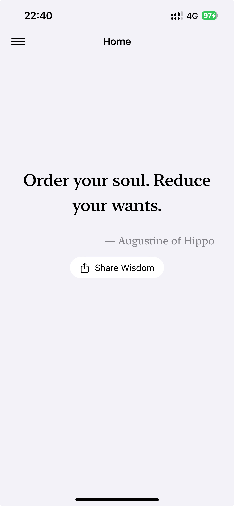
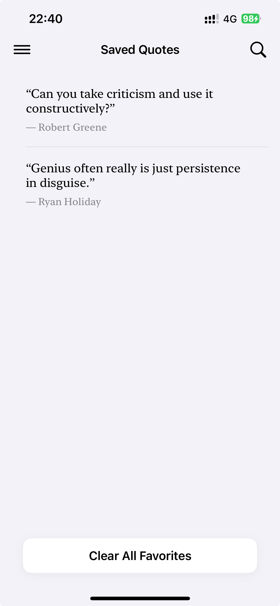

# StoicismDaily – Daily Stoic Wisdom

**StoicismDaily** is a minimalist and elegant iOS app designed to bring you timeless wisdom from the ancient Stoic philosophers. Through daily notifications and an immersive reading experience, it helps you find inner calm and strength amid the busyness of modern life.

---

## 📸 UI Preview

| Home | Saved |
| :---: | :---: |
|  |  |

---

## ✨ Core Features

- **Daily Wisdom**  
  Receive a carefully selected Stoic quote each day from masters like Seneca, Marcus Aurelius, and Epictetus.

- **Gesture Interactions**  
  - **Swipe Left**: Load a new random quote and explore more insights  
  - **Double Tap**: Instantly save a quote you love, with a refined heart animation

- **Quote Collection**  
  Build your own personal library of wisdom and revisit the words that inspired you.

- **Search Functionality**  
  Quickly find specific quotes in your collection using keywords.

- **Daily Reminders**  
  Customize notification timing so you never miss your daily dose of philosophy.

- **Sharing**  
  Easily share meaningful quotes with friends or on social platforms.

- **Beautiful Design**  
  Optimized for both iPhone and iPad, featuring a modern aesthetic aligned with Stoic philosophy.

---

## 🛠 Tech Stack

- **SwiftUI** – Declarative and reactive UI framework  
- **SwiftData** – Local persistence for saved quotes  
- **Combine / ObservableObject** – Efficient data flow and state management  
- **UserNotifications** – Reliable daily reminder system  
- **RESTful API** – Fetches quotes from https://stoic.tekloon.net/stoic-quote  

---

## 🚀 Getting Started

1. Clone this repository  
2. Open `StoicismDaily.xcodeproj` using the latest version of Xcode  
3. Select a simulator or connect your device  
4. Click **Run** to build and launch the app  

---

## 📖 About Stoicism

**Stoicism** is an ancient Greek philosophy that emphasizes logic, reason, and living in harmony with nature. It teaches us to focus on what we can control and to accept what we cannot with clarity and composure.

---

*“You have power over your mind—not outside events. Realize this, and you will find strength.” — Marcus Aurelius*